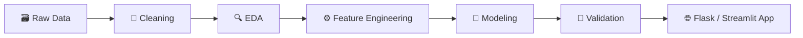

 

---

## 👋 About Me

I'm a **B.Tech Computer Science student (AI/ML specialization)** at **VIT Bhopal University** (expected 2027) who enjoys the full data workflow: **cleaning data → exploring it → engineering features → modeling → shipping it as an app people can actually use.**

- 🔭 Built **3 end-to-end ML projects**: regression, classification and a recommender system
- 🖥️ Every model ships with an **interactive Flask or Streamlit interface**
- 📐 Solid base in **statistics, probability and SQL**
- 🎓 Certified in **Applied Machine Learning in Python** (University of Michigan) and **AI Fundamentals** (Oracle, IBM)
- 🎯 **Currently seeking an entry-level Data Scientist role**

> 💡 **Recruiters:** jump to [🚀 Projects](#-projects), [🧰 Tech Stack](#-tech-stack) or [📬 Let's Connect](#-lets-connect).

---

## ⚡ At a Glance

| 🎓 Education | 🧪 ML Projects | 📜 Certifications | 📊 Best Model Accuracy |
|:---:|:---:|:---:|:---:|
| **B.Tech CSE (AI/ML)** VIT Bhopal, CGPA 7.46 | **3** Regression, Classification, Recommender | **4** Michigan, Oracle, IBM, Google | **~80%** IPL win predictor (validation split) |

---

## 🚀 Projects

> 👇 **Click each project to expand the details.**

<b>🚗 Car Price Predictor</b> &nbsp;|&nbsp; <i>Regression + Flask web app</i>

 

**What it does:** Estimates the price of a used car from details the user enters.

- Cleaned the data and ran EDA and preprocessing with **Pandas** and **NumPy**
- Trained a **Linear Regression** model with **Scikit-learn**
- Integrated the model into a **Flask** backend with an HTML/CSS front end for live predictions

🔗 [**View Repository →**](https://github.com/Rohit-codex/car_price_predictor)

<b>🏏 IPL Win Probability Predictor</b> &nbsp;|&nbsp; <i>Classification + Streamlit app</i>

 

**What it does:** Estimates each team's win probability during an IPL second-innings chase, from teams, city, target, score, overs and wickets.

- Engineered match-state features: **runs remaining, balls remaining, wickets remaining, current run rate, required run rate**
- Built from Kaggle match and ball-by-ball datasets
- Trained a Scikit-learn **pipeline (One-Hot Encoding + Logistic Regression)**
- Reached **~80% accuracy** on its validation split

🔗 [**View Repository →**](https://github.com/Rohit-codex/IPL_Win_Probability_Predictor)

<b>📚 Book Recommender System</b> &nbsp;|&nbsp; <i>Collaborative filtering + Flask app</i>

 

**What it does:** Returns four similar books for any selected title, plus a top-50 popularity list.

- Used the **Book-Crossing dataset (Kaggle)**; cleaned and merged ratings with book metadata
- Filtered to **active readers (200+ ratings)** and **established books (50+ ratings)** to build a book-by-reader rating matrix
- Ranked similar books with **cosine similarity**
- Built the popularity list from books with **250+ ratings**, served through **Flask**

🔗 [**View Repository →**](https://github.com/Rohit-codex/Book_Recommender_System)

---

## 🧰 Tech Stack

**Languages**

**Data Science & ML**

**Frameworks & Deployment**

**Tools**

---

## 🔄 How I Work with Data

---

## 🎓 Education

**VIT Bhopal University**, Bhopal, India
B.Tech in Computer Science, Specialization in AI/ML
**CGPA: 7.46 / 10** &nbsp;|&nbsp; Expected graduation: **2027**

---

## 📜 Certifications

| Certification | Issuer | Date |
|---|---|---|
| 🤖 Applied Machine Learning in Python | University of Michigan (Coursera) | Jan 2026 |
| ☁️ Oracle Cloud Infrastructure 2025 Certified AI Foundations Associate | Oracle University | Nov 2025 |
| 🧠 AI Fundamentals: Foundations for Understanding AI | IBM SkillsBuild | May 2026 |
| 🛠️ Google IT Support Certificate | Google Career Certificates | Mar 2026 |

---

## 📊 GitHub Stats

---

## 📬 Let's Connect

I'm looking for an **entry-level Data Scientist** opportunity, and I'd love to talk about data, ML, or how I can contribute to your team.

| | |
|---|---|
| 📧 **Email** | [rohit.malik28004@gmail.com](mailto:rohit.malik28004@gmail.com) |
| 💼 **LinkedIn** | [linkedin.com/in/rohit-malik-ab227928b](https://linkedin.com/in/rohit-malik-ab227928b) |
| 🌐 **Portfolio** | [rohit-malik-portfolio.netlify.app](https://rohit-malik-portfolio.netlify.app) |
| 💻 **GitHub** | [github.com/Rohit-codex](https://github.com/Rohit-codex) |

⭐ *Thanks for stopping by. If you like what you see, let's talk!* ⭐

